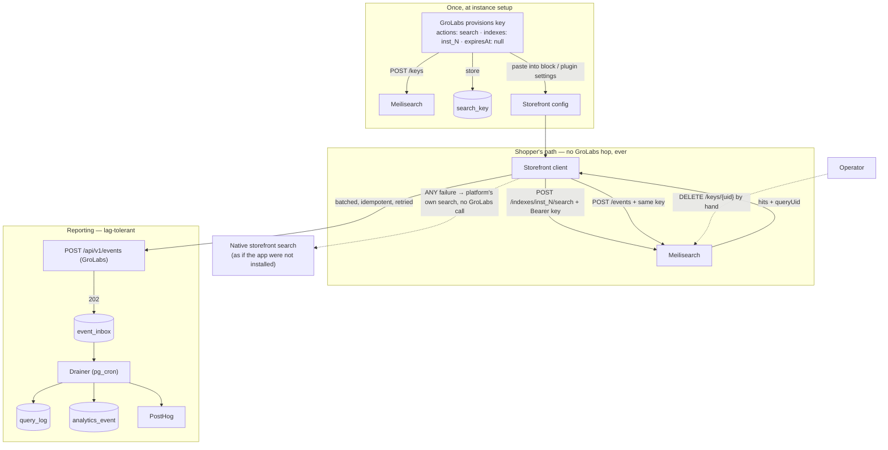
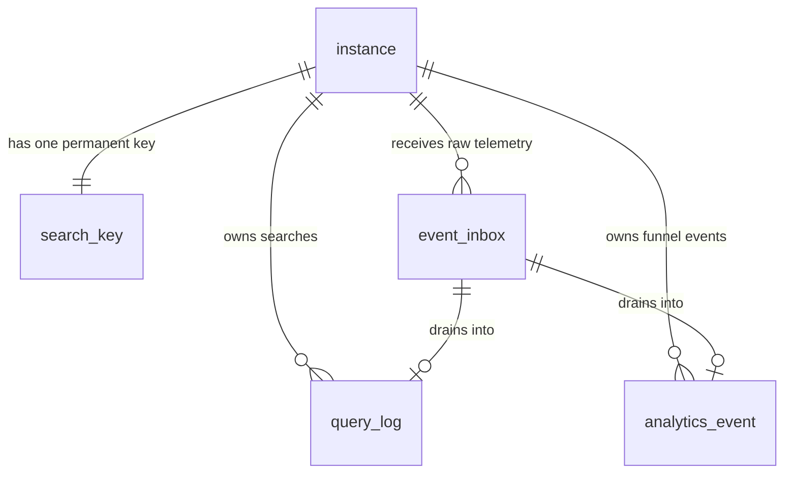

# Direct-to-Meilisearch Search — implementation plan

**Decided 2026-11-02.** Owner: Tuncho. Executes the direct-connect option that
`search-proxy-event-pipeline.md` §6 left open, and answers its "separate service vs
in-app" question sideways: the search path has no GroLabs service in it at all, and
what remains in-app is ingest.

> **The shape of the decision.** Uptime beats enforcement. One permanent, non-expiring,
> search-only key per instance, configured once into the storefront. Nothing GroLabs
> runs on a schedule can take a merchant's search down, because GroLabs runs nothing in
> that path. If a merchant stops paying, an operator deletes their key by hand. At well
> under 100 tenants that is cheaper than any mechanism that could fail on its own.

## Flow

## Failover — how we decide Meilisearch is not answering

**Measured 2026-11-02 from `query_log`** (574 successful searches, instances 16 + 99999):

| | p50 | p95 | p99 | max |
|---|---|---|---|---|
| Meilisearch processing time | 6ms | 8–13ms | 10–13ms | **18ms** |

**5 seconds is the wrong order of magnitude** for a deadline: Meilisearch's slowest
response in 574 searches was 18ms, so 5s is ~270x the worst case ever observed.

(The retired proxy's own round-trip over the same searches — `total_handler_ms` p50
295–338ms, p99 851ms — is kept only as the Gate 1 "before" baseline. It does not inform
the deadline, and the storefront never calls it: every failure goes local, per R-8.)

And a 5s deadline fails in the direction that hurts. If Meilisearch is *dead*, the
browser finds out in milliseconds — DNS failure and connection-refused do not wait. The
deadline only ever applies to the *slow* case, and there the shopper pays the full 5s
**and then** waits for native search to run. That is worse than having no fallback at
all, and it happens precisely when Meilisearch is under load, i.e. when many shoppers
hit it at once.

So: **1000ms for typeahead, 2500ms for a committed search**, via
`AbortSignal.timeout`. The typeahead number is
sized for a cold connection on mobile — DNS + TLS before the 6ms query — not for
Meilisearch being slow, which it has never been. Warm requests will land near 60–160ms.
No retry on typeahead: the next keystroke supersedes the request anyway.

Then the error-class split (R-18) and the 2-strikes/60s breaker, so an incident costs a
shopper one deadline rather than one per keystroke. And no `/health` pre-flight, ever
(R-19) — detection for *us* is a pg_cron probe plus the `search_failed` records the
telemetry batch already carries.

## Data model

- **search_key** (shipped 2026-11-02, migration `20261102000001_search_key.sql`) —
  `search_key_id` bigserial PK, `instance_id` FK, `key_uid`, `key_value`, `key_name`,
  `created_at`, `created_by`, `revoked_at`, `revoked_by`. Append-only with a partial
  unique index on `instance_id WHERE revoked_at IS NULL`, so at most one key is live
  per instance while revoked rows persist as the audit trail — the plan's first sketch
  keyed on `instance_id` alone, which left no trace of a cutoff and so could not
  satisfy R-9. `key_value` is plaintext on purpose: it is a public, read-only
  credential the merchant must be able to re-read. RLS is deny-all; reached only from
  `src/lib/search/search-key.ts` under the service-role client.
- **event_inbox** (new) — `event_id` PK (client-generated, the idempotency key),
  `instance_id`, `kind` (`search_performed` | existing event types), `payload` jsonb,
  `received_at`, `processed_at`. Append-only; pgmq is the alternative if available.
- **query_log** — unchanged shape. `denial_reason`, `status` and `total_handler_ms`
  become proxy-only artifacts, NULL for direct-mode rows.
- **analytics_event** — unchanged; now written by the drainer rather than inline.
- **instance** — unchanged. `storefront_domains` still gates the retained proxy.

## Phases

Each numbered item is one prompt's worth of work. Gates are blocking.

> **Phase 1 landed 2026-11-02.** Migration applied and verified against the live DB;
> `src/lib/search/search-key.ts` owns the lifecycle; the panel is on
> `/configuration/search`; 8 integration tests pass against real Meilisearch
> (including cross-instance refusal and detection of a key deleted by hand).
> Typecheck and build green. Nothing is wired into a storefront yet — Phase 2 next.

**Phase 1 — permanent key provisioning (GroLabs side)**

1. Migration: `search_key` table.
2. `getOrCreateInstanceSearchKey(instanceId)`: look up `search_key`; if absent,
   `createKey({ name: "grolabs-inst-N", actions: ["search"], indexes: ["inst_N"],
   expiresAt: null })` and store uid + value. Never list keys (R-6).
3. `revokeInstanceSearchKey(instanceId)`: `deleteKey(uid)`, stamp `revoked_at`.
4. Surface it on `/configuration/search`: the key, its status, a copy button, and a
   revoke action. This screen is what makes R-9 true.
5. Offboarding runbook step: delete the key, confirm the storefront degrades.
6. Vitest on instance 99999: creation is idempotent, scope is one index, revocation
   kills search, no cross-instance leakage.

**Phase 2 — deliver the key to the Shopify storefront**

7. Add `search_key` + `meilisearch_host` to the `grolabs-storefront` extension's block
   settings, beside the existing `instance_id` / `api_host`. One-time merchant paste
   (or CLI), no new Shopify scope, no re-authorization. `embed.liquid` also emits
   `preconnect` + `dns-prefetch` for that host (R-21).
8. Same two settings for the `grolabs-pixel` extension, so the pixel stops fetching an
   events token per page (R-5).

**Phase 3 — direct search + direct events in the storefront**

9. Port `pickMatchedVariation` + the facet allowlist into the shared client bundle.
10. `grolabs-typeahead.js` and `grolabs-results.js`: query
    `POST {host}/indexes/inst_N/search` with `Authorization: Bearer <key>` and
    `Meili-Include-Metadata: true` — raw `fetch`, no SDK (R-23) — with
    `attributesToRetrieve` trimmed to the rendered fields plus `variants` (R-22). Apply
    the ported matcher; keep the render contract identical. Suppress native only on
    results arrival, per R-20/R-24. CORS from the storefront is already proven by
    today's events path.
11. `grolabs-events.js` + the pixel: submit to Meilisearch `/events` with the config
    key; delete the token-fetch path.
12. Failover, per R-16 through R-20: `AbortSignal.timeout(1000)` on typeahead, `2500` on
    the results page; the 2-strikes/60s `sessionStorage` breaker; the error-class split
    (403 = revoked, degrade for the session, no retry; 429 = back off; timeout/5xx = count
    toward the breaker). Every branch ends at the platform's own search and none of them
    calls GroLabs. Audit the extension for suppression that fires at init rather than on
    results — that is what makes stepping aside possible (R-20). Log loudly; silent
    degradation is the failure mode this whole plan exists to avoid.
13. Server-side detection for us, not the shopper: a pg_cron probe hitting Meilisearch
    `/health` plus a canary search per active index, writing outcomes to
    `backend_operation`.

**Phase 4 — ingest + drain (GroLabs side)**

14. `/api/v1/events`: accept a batch array and a new `search_performed` kind, require
    `event_id`, append to `event_inbox`, return 202. Keep the single-event path working.
    Ships the `query_log.estimated_total_hits` migration and pins what the client reports
    into which column (R-26) — decide this before any direct-mode row is written, because
    a mid-flight change of meaning is not recoverable from the data.
15. Drainer (pg_cron): batch `event_inbox` → `query_log` + `analytics_event`, upsert on
    `event_id`, compute `intent_group_id` at drain, forward to PostHog, mark processed.
    Failures land in `backend_operation`.

**Phase 5 — storefront telemetry**

16. Batch queue in the extension: accumulate `search_performed` + funnel events, flush
    on 5s idle / page unload (`keepalive`), persist unsent batches to localStorage and
    retry on the next page view.
17. Dual-report every committed search (direct + proxy) behind a flag, for R-14.

**Phase 6 — guardrail. Blocking before any traffic moves.**

18. WAF rate limit in front of the Meilisearch host, per IP. Verify a synthetic flood
    is throttled at the edge and never reaches the cluster. This matters more than it
    did under the old design: the key is permanent, so nothing expires an abuser out.

**Gate 1 — positive path (T-1, T-2)** on instance 16: direct search returns results,
latency measured against the proxy baseline, every search lands in `query_log` with the
proxy's field set, the five-event funnel still attributes through a test order, and the
network log shows no GroLabs token calls. Report the measured browser-loss ratio from
step 16.

**Gate 2 — outage path (T-3)**: take GroLabs down deliberately, confirm search keeps
working, telemetry queues, and the queue flushes with no loss on recovery. How we
simulate the outage is an open decision below. Run T-4 and T-5 in the same session —
revocation is the other half of the availability bet.

**Phase 7 — cleanup**

19. Turn off dual-reporting; the proxy keeps serving ingest + back-compat only (R-11).
20. Amend `search-proxy-event-pipeline.md` (§6 answered; §2's hot-path hardening is
    mostly moot once the hot path is gone) and `docs/policy/search-foundations.md` §7
    (the proxy is no longer the storefront's primary path). `search-events.md` §4
    best-effort is superseded by R-10 — needs explicit sign-off per its own §8.
21. `grolabs-web-sdk`: its README promises "search, browser, no key". Direct mode
    contradicts that; the SDK needs a key story or an explicit two-mode README.

## Operator runbook — cutting an instance off

Enforcement is manual by decision (R-2): uptime matters more than stopping a
non-payer quickly, and at well under 100 tenants a human step costs nothing. It is
only real if someone performs it, so it is written down here rather than implied.

**To cut off an instance**

1. Open `/configuration/search` as a member of that instance. The **Storefront key**
   card shows the key and its state.
2. Click **Revoke key** and confirm. The key is deleted in Meilisearch and the row is
   stamped `revoked_at`.
3. The storefront stops returning results within seconds. Its catalog index is
   untouched — nothing needs re-ingesting if they come back.
4. Confirm on the storefront: search should fall back to the platform's own results
   (R-8/R-20), not error.

**Or by hand, in the Meilisearch console** — delete the key named `grolabs-inst-N`.
This is equally valid and equally immediate. Afterwards the panel reads
**DELETED IN MEILISEARCH**: it verifies the key against Meilisearch on load rather
than trusting our own row, so a by-hand deletion shows up instead of the panel
continuing to claim the instance is live. Click **Record revocation** there to bring
the record back in step.

**To reactivate** — click **Issue key** and paste the new value into the merchant's
Shopify block settings. The old key is dead and stays in the history.

**Known gap** (R-28): a key whose DB row was lost — a crashed provision, a manual
DB edit — keeps working and is invisible to this panel, because names are not unique
upstream and we deliberately never list keys to find ours. Until reconciliation
exists, an audit means looking in the Meilisearch console for keys scoped to
`inst_N` that the panel does not show.

## Related GroLabs modules

- **Search** — `/api/v1/search` (retained for ingest + back-compat, never a storefront fallback), `/api/v1/search/token` and
  `/api/v1/events/token` (retired for new storefront builds, kept for back-compat),
  `meilisearch-client.ts`, `variant-matcher.ts`, `rate-limit.ts`.
- **Analytics / event tracking** — `query_log`, `analytics_event`, `metric_daily`,
  `src/lib/analytics/metrics.ts`. The KPI catalog is unchanged; only who writes the
  rows changes.
- **Shopify search app** (`shopify-apps/grolabs-shopify-search`) — both extensions
  (`grolabs-storefront`, `grolabs-pixel`).
- **WordPress search plugin** (`wp-plugins/grolabs-wordpress-search`) — **out of scope,
  frozen** (R-12). Not touched by this plan and not awaiting parity.
- **Instance configuration** — `/configuration/search` gains the key panel (step 4).
- **Observability** — `backend_operation` for drainer and ingest failures.

## External apps + credentials

| What | Credential | Where it lives | Notes |
|---|---|---|---|
| Meilisearch | `MEILISEARCH_MASTER_KEY` | GroLabs server env | Only key/index admin uses it. Never leaves the server. |
| Meilisearch | per-instance search key, permanent | **search_key** + storefront config + page source | New. Read-only, one index, never expires. Covers search AND events. Revocation target. |
| Cloudflare / WAF | account + zone for the Meilisearch host | Ops | New. Blocking for Gate 1. |
| PostHog | `POSTHOG_API_KEY` | GroLabs server env | Unchanged; forwarding moves to the drainer. |
| Shopify | existing app token | Shopify app backend | **No new scope** — the key ships as a block setting. |

## Open decisions

1. **How we simulate the outage for Gate 2.** Pausing the Vercel production deployment
   is the most honest; a kill-flag that 503s every route is safer but tests less.
2. **pgmq vs a plain `event_inbox` table.** The pipeline doc leans pgmq; a plain
   append-only table is less to learn and enough at current volume.
3. **Whether tenant-token minting survives at all.** It is the only path to filtered
   search (per-shopper visibility, B2B price groups, a shared index). Keeping the code
   costs nothing; relying on it again would reintroduce expiry.
4. **Whether the permanent key is per instance or per storefront domain.** Per instance
   is simpler and matches index-per-instance; per domain would let one merchant's
   staging storefront be cut off independently.
5. **Numbered pages or load-more** (R-25). Load-more keeps today's cheap estimate;
   numbered pages need `page`/`hitsPerPage`, exact counts, a slower query per search, and
   a `maxTotalHits` raised above its 1000 default for any catalog that warrants it. This
   is a product decision that happens to set a performance cost, so it belongs to you,
   not to the implementation.
6. **Whether telemetry goes through a Shopify App Proxy** (`/apps/grolabs/…`, a
   same-origin path on the shop domain that Shopify forwards to our backend). It would
   make the beacon first-party and dodge the main cause of client-side loss. It does
   NOT survive a GroLabs outage — the proxy terminates at us — so it complements the
   localStorage retry queue rather than replacing it. Now that WordPress is out (R-12),
   this is the only remaining lever on telemetry fidelity; decide it off R-14's measured
   loss ratio rather than up front.
