# Event semantics — one journey, every branch named

`direct-search-testing.md` proves the **plumbing**: a row arrives, a batch is
idempotent, a seq gap is detected. It does not prove the row **means** what the
definition says. This document does that, by taking one journey, naming the
branch every event should take per the definitions, and recording the branch it
actually takes.

Measured **2026-11-02** against the real code and the live `scout` database.
Nothing here is predicted; §7 says how to re-run it.

> **F-1, F-2 and F-3 were fixed the same day** — see §8. The trace below is kept
> as the record of what was found, because the findings are the reason the code
> is the way it is now. Each fixed finding carries its before/after numbers.
> F-4 through F-8 are **open**.

**The definitions being tested** live in three places:
`conversion-measurement-foundations.md` §3 (the grammar: user / session / intent
/ journey, the four reformulation types), `event-tracking.md` §2–§3 (taxonomy and
identity), `search-events.md` §2 (the Meilisearch fence).

---

## 1. The journey

One person, one browser, four visits. Chosen so every branch the grammar defines
gets exercised exactly once — all four reformulation types, a session boundary by
inactivity, a session boundary by day, login, and a second device.

| Visit | When | What they do | Why it is in the script |
|---|---|---|---|
| 1 | 11-02 10:00 | types, typos, fixes it, narrows, clicks, buys | correcting + narrowing + the full funnel |
| 2 | 11-02 10:50 | searches again after 45 min | broadening + lateral + inactivity boundary |
| 3 | 11-03 09:00 | returns next day, **logs in** | day boundary + the merge point |
| 4 | 11-03 20:00 | same human, **different device** | cross-device identity |

---

## 2. Visit 1 — every event, as recorded

`I1…I9` are the real `intent_group_id` values the real `assignIntent` produced,
shortened. **Each one is a distinct id.**

| # | Time | Shopper did | Emitted | Lands in | `is_committed` | Recorded intent | Branch per the definition | Match |
|---|---|---|---|---|---|---|---|---|
| 1 | 10:00:00.0 | types `sn` | Meili search + `search_performed` | `query_log` | `false` / `typeahead` | **I1** | keystroke — *counts for nothing* | ✗ mints an intent |
| 2 | 10:00:00.6 | `snow` | same | `query_log` | `false` | **I2** | keystroke | ✗ |
| 3 | 10:00:01.4 | `snwo` | same | `query_log` | `false` | **I3** | keystroke | ✗ |
| 4 | 10:00:02.2 | `snwoboard` | same | `query_log` | `false` | **I4** | keystroke | ✗ |
| 5 | 10:00:04 | hits Enter → `snwoboard`, 0 hits | `search_performed` | `query_log` | `true` / `results_page` | **I4** | **new intent** (zero-result) | ~ inherits the keystroke's id |
| 6 | 10:00:12 | types `snowboard` | same | `query_log` | `false` | **I5** | keystroke | ✗ |
| 7 | 10:00:14 | Enter → `snowboard`, 13 hits | `search_performed` | `query_log` | `true` | **I5** | **CORRECTING → same intent as #5** | ✗ new intent |
| 8 | 10:00:31 | types `complete snowboard` | same | `query_log` | `false` | **I6** | keystroke | ✗ |
| 9 | 10:00:33 | Enter → `complete snowboard`, 1 hit | `search_performed` | `query_log` | `true` | **I6** | **NARROWING → same intent** | ✗ new intent |
| 10 | 10:00:40 | clicks the result | `click` | `analytics_event` | — | *no intent column* | click attributed to #9 | ✓ `query_uid` set |
| 11 | 10:00:42 | PDP renders | `view` | `analytics_event` | — | — | view | ✓ |
| 12 | 10:01:20 | adds to cart | `conversion` | `analytics_event` | — | — | conversion, `placement=pdp` | ✓ |
| 13 | 10:03:00 | checkout | `conversion` | `analytics_event` | — | — | conversion | ✓ |
| 14 | 10:05:00 | order placed | `conversion` | `analytics_event` | — | — | conversion → **intent 1 satisfied** | ✗ no intent to satisfy |

## 3. Visits 2–4 — the rest of the branches

| # | Time | Shopper did | Recorded intent | Recorded session | Branch per the definition | Match |
|---|---|---|---|---|---|---|
| 15 | 11-02 10:50:00 | `ski wax`, 3 hits | **I7** | `bidA` seq **2** | new session + new intent | ✓ both |
| 16 | 11-02 10:50:20 | `wax`, 5 hits | **I8** | `bidA` seq 2 | **BROADENING → same intent** | ✗ new intent |
| 17 | 11-02 10:51:00 | `snowboard wax`, 2 hits | **I9** | `bidA` seq 2 | **LATERAL (vocabulary gap) → same intent** | ✗ new intent |
| 18 | 11-03 09:00:00 | returns, logs in, `goggles` | new | `bidA` seq **3** | same user, new session (day boundary) | ✓ |
| 19 | 11-03 09:00:30 | adds to cart | — | `bidA` seq 3 | **account_id appears = merge point** | ✗ see §5 |
| 20 | 11-03 20:00:00 | **other device**, `goggles` | new | `bidB` seq **1** | same human, 4th session | ✗ session counter restarts |
| 21 | 11-03 20:00:40 | buys | — | `bidB` seq 1 | same human's journey | ✗ no cross-device rollup |

Sessions came from the real `session_assignment` window logic. The 30-minute
gap and the store-local day boundary **both work exactly as defined.**

---

## 4. The trace as a diagram

Edge label = the branch the definition says to take. Node = what the system
recorded. Red = the two disagree.

```mermaid
flowchart TD
  classDef ok fill:#e8f5e9,stroke:#2e7d32,color:#1b5e20
  classDef bad fill:#ffebee,stroke:#c62828,color:#b71c1c
  classDef neu fill:#f5f5f5,stroke:#9e9e9e,color:#424242

  ID["<b>Anonymous shopper</b><br/>user_id = localStorage 'grolabs_search_session_id'<br/>+ mirrored to cookie 'grolabs_bid'<br/>persistent per BROWSER — despite the name, not a session"]:::neu

  subgraph V1["Visit 1 — session_seq 1"]
    K1["probe 'sn' → <b>I1</b>"]:::bad
    K2["probe 'snow' → <b>I2</b>"]:::bad
    K3["probe 'snwo' → <b>I3</b>"]:::bad
    K4["probe 'snwoboard' → <b>I4</b>"]:::bad
    C1["<b>committed</b> 'snwoboard'<br/>0 hits → <b>I4</b>"]:::neu
    C2["<b>committed</b> 'snowboard'<br/>13 hits → <b>I5</b>"]:::bad
    C3["<b>committed</b> 'complete snowboard'<br/>1 hit → <b>I6</b>"]:::bad
    E1["click — query_uid of C3, position 0"]:::ok
    E2["view — PDP"]:::ok
    E3["conversion 'Added to cart' — placement=pdp"]:::ok
    E4["conversion 'Proceeded to check out'"]:::ok
    E5["conversion 'Completed order'"]:::ok
  end

  subgraph V2["Visit 2 — session_seq 2, +45 min"]
    C4["<b>committed</b> 'ski wax' → <b>I7</b>"]:::ok
    C5["<b>committed</b> 'wax' → <b>I8</b>"]:::bad
    C6["<b>committed</b> 'snowboard wax' → <b>I9</b>"]:::bad
  end

  subgraph V3["Visit 3 — session_seq 3, next day, LOGGED IN"]
    C7["<b>committed</b> 'goggles' + account_id"]:::ok
    E6["conversion 'Added to cart'<br/>account_id = NULL (pixel never sets it)"]:::bad
  end

  subgraph V4["Visit 4 — SAME HUMAN, other device"]
    C8["<b>committed</b> 'goggles'<br/>user_id = bidB, session_seq restarts at <b>1</b>"]:::bad
    E7["conversion 'Completed order'"]:::bad
  end

  ID --> K1
  K1 -->|"keystroke: counts for nothing"| K2
  K2 -->|"keystroke"| K3
  K3 -->|"keystroke"| K4
  K4 -->|"commit"| C1
  C1 -->|"<b>CORRECTING</b> → same intent"| C2
  C2 -->|"<b>NARROWING</b> → same intent"| C3
  C3 -->|"click"| E1
  E1 -->|"view"| E2
  E2 -->|"add"| E3
  E3 -->|"checkout"| E4
  E4 -->|"order → intent SATISFIED"| E5
  E5 -->|"45 min gap → new session, new intent"| C4
  C4 -->|"<b>BROADENING</b> → same intent"| C5
  C5 -->|"<b>LATERAL</b> (vocabulary gap) → same intent"| C6
  C6 -->|"next day → new session"| C7
  C7 -->|"<b>MERGE POINT</b>: anonymous history attaches to the human"| E6
  E6 -->|"same human, different browser"| C8
  C8 -->|"order"| E7
```



**Expected:** 1 user · 4 sessions · **2 intents** (`a snowboard`, then `wax for
it`) · 4 named reformulation branches · 1 human after login.
**Recorded:** 2 user_ids · 4 sessions (numbered 1,2,3 then 1 again) · **9
intents** · 0 reformulation branches · no handle that means the human.

---

## 5. Findings, with the measured number

### F-1 · `intent_group_id` is a query grain, not a demand grain
All four reformulation types start a **new** intent. The only queries that group
are ones that were never reformulations — plurals, word order, accents. In the
journey: **9 intent ids where the grammar says 2**, and **6 committed searches →
6 distinct intents**, i.e. one intent per search.

Confirmed in live data, not just the script: across every user-day in
`query_log` with committed searches and an intent id, `distinct_intents` equals
`distinct_queries` — **2 of 2 user-days, 0 where grouping collapsed anything.**

Consequence: `reformulation_rate` is defined as "intents needing ≥1 rewrite ÷
intents". With one query per intent it returns a confident **~0%** rather than
failing. Its `blockedReason` in `metrics.ts` says "needs intent-grain rollup",
which understates it — the grain exists and carries the wrong contents.

**FIXED.** `classifyReformulation()` decides narrowing and broadening by set
containment and correcting by bounded Damerau-Levenshtein, using
**Meilisearch's own typo thresholds** (`minWordSizeForTypos`: one error from 5
characters, two from 9) rather than a number of our own — so a pair the engine
would treat as the same word is a pair we call a typo. `assignIntent` now joins
the first related query in a 30-minute window and returns the type plus the
query it was judged against; `reformulation_type` and `previous_query` are new
columns (migration `20261102000007`). Same journey, re-run: **4 intents, was
9**, with four reformulations named and `reformulation_rate` = 2/4 =
**0.500** instead of a structural zero.

The definition says **3** demands, so one extra intent remains — and it is
**F-6, not F-1**. Steps 18 and 20 are the same human searching the same word
(`goggles`) on two devices; the window is scoped to `(instance_id, user_id)`
and nothing rolls intents up by `account_id`, so a second browser is a second
person. Fixing the grouping made that visible instead of hiding it in the noise
of nine intents.

**One divergence remains, by design.** Step 20 classifies as *narrowing*, not
*lateral*. The chain judges each query against its immediate predecessor, and
`wax` → `snowboard wax` does add a criterion; read against the query that
*opened* the intent (`ski wax`) it is a descriptor swap — the vocabulary gap,
and the more valuable signal, since its remedy is a synonym rather than a facet.
An intervening broadening hides it. Catching it means classifying against both
the predecessor and the opening query, which is a second axis rather than a bug
fix, so it was not done. `classifyReformulation("ski wax", "snowboard wax")`
does return `lateral`, covered in the unit tests — the type is reachable; this
particular journey routes around it.

### F-2 · A keystroke mints the intent id the committed search inherits
The grammar says a keystroke "counts for nothing". But `logRequest` assigns an
intent to **every** successful search including typeahead probes, so steps 1–4
created I1–I4, and the committed search at step 5 inherited **I4** — the id
minted by the last prefix that happened to match. The thing that counts for
nothing is what names the thing that counts.

Second-order: the intent window is the last 10 rows for that `(instance, user)`,
and probes outnumber commits, so a committed search's window can be entirely
prefix noise. The window also has **no time bound**, so an id can be inherited
across days.

**FIXED.** A probe is still logged, but it no longer mints an intent and no
longer enters the window — both the search route and the drainer require
`is_committed IS NOT FALSE` (matching `metric_daily_source`, so a legacy NULL
row still participates in its own chain). The window is bounded to 30 minutes,
matching `session_assignment`, so an intent cannot outlive its session; the
bound is enforced inside `assignIntent` as well as in the SQL, so a caller that
forgets the clause cannot silently produce week-long intents. In the re-run all
six probes carry `intent_group_id` NULL.

### F-3 · Event time is lost — `created_at` is drain time
The hard one, because it silently degrades every time-based KPI.

- the storefront **never stamps an event time** (`enqueue()` sets `event_id`,
  `kind`, `seq`, `session_id` — no timestamp);
- `event_inbox` has only `received_at default now()` — when the *batch arrived*;
- the drain's inserts into `query_log` / `analytics_event` **omit `created_at`
  entirely**, so it defaults to `now()` — **when the drain ran**.

So every event in a drain window collapses to one instant. `session_assignment`
reads `created_at` for its 30-minute gap rule, `instance_day()` buckets the KPI
day from it, and `time_to_first_click` is a difference between two of them. The
retry queue makes it worse: events held in `localStorage` across a page view
are stamped whenever they finally land, which can be a different day.

**And the drain is not scheduled.** `vercel.json` has one cron
(`ga4/poll`); there is no pg_cron entry and no Vercel cron for
`/api/v1/events/drain`. The live inbox shows 7 rows, all processed, `processed_at`
2026-11-02 22:37 — the manual verification run. In direct mode nothing reaches
`query_log` until someone invokes the endpoint by hand, and everything then lands
timestamped at that moment.

The journey's own numbers only came out right in §3 because the script supplied
true event times. The pipeline would not have preserved them.

**FIXED, and not with a timestamp.** The storefront reports how long **ago** the
event happened (`age_ms`); the receiver computes
`occurred_at = received_at − age_ms` against our clock, clamped to 30 days; the
drain writes it to `created_at`, falling back to `received_at` for a client too
old to report an age. Both readings behind that age come from the device's own
clock, so a phone set to the wrong year still reports a correct age and the
error cancels — an absolute client timestamp would have imported every broken
clock on the internet into the KPI series. The drain now also **walks** the
batch in event-time order, not arrival order, because the retry queue can
deliver an old event after a newer one and intent chaining reads each query
against the ones before it.

**The drain is scheduled, from Postgres rather than Vercel.** A Vercel cron
was the obvious answer and it was tried twice: `*/5 * * * *` was rejected at
deploy, taking the whole `vercel.json` with it, and `*/10 * * * *` is the same
shape. This project's plan allows two cron jobs at **daily** granularity, and
one is already spent on `ga4/poll` — a once-a-day drain would mean telemetry up
to 24 hours stale, which is not a monitoring surface anyone would act on. So the
schedule lives in `pg_cron`, which is the repo's own existing answer:
`search_probe_tick` has run there every 5 minutes since this morning.

`event_drain_tick()` (migration `20261102000008`) does not drain — it rings the
doorbell, and the route does the work, so `assignIntent` stays in one language.
It fires through `pg_net`, records the request id, and collects the outcome on
the next tick, logging to `backend_operation` **only** when the call failed or
never came back; a successful drain already logs its own counts from inside the
route, so logging it twice would double-count every run. "The drain silently
stopped" is the failure this closes, so it must not be able to happen quietly in
the new mechanism either.

The caller presents `DRAIN_CRON_SECRET`, not `CRON_SECRET`, and the route now
accepts either. A schedule that lives in the database means the caller's secret
lives in a table (`event_drain_config`, deny-all RLS, same trade as
`search_key.key_value` — a secret that must be *presented* cannot be hashed).
Putting `CRON_SECRET` there would have widened the blast radius of a database
read to **every** cron route; a scoped secret widens it to this one, whose whole
power is "move the inbox along".

It matters less than it did: now that event time is carried, a lagging drain
delays availability rather than corrupting history, so the interval is a latency
choice, not a correctness one.

Not backfilled. Rows written before this carry drain time and the information to
correct them was never sent; the discontinuity is dated in the migration, as
v0.9.0's page-relative click positions are dated in `event-tracking.md` R-4.
The pixel path never had this bug — it posts one event synchronously, so its
`created_at` was always the real event time.

### F-4 · `account_id` is absent where revenue is
`conversionPayload()` in the pixel sets `eventType`, `eventName`, `objectId`,
and attribution — **never `accountId`**. The pixel owns add-to-cart, checkout and
completed-order, so the revenue events carry no account. Theme-side events
(click, view) do.

Live, on the Shopify instance: `with_account = 0` on **every event name** —
`Product viewed` 8 rows, `Search Result Clicked` 4, `Added to cart` 3,
`Proceeded to check out` 3, `Completed order` 3. The only populated `account_id`
values in the whole table belong to instance 99999's July seed data.

So "login is the merge point" is unexercised: there has never been a row where a
Shopify human's account met their behaviour.

### F-5 · The account hash does not match its own definition
`event-tracking.md` R-3 specifies "opaque **SHA-256** over `(instance_id, WC user
id)` — never raw, never PII". The Shopify embed emits
`{{ customer.id | append: '' | md5 }}` — **md5, of the bare customer id, with no
instance salt**. Customer ids are small integers, so the hash is reversible by
brute force in milliseconds. It is opaque in form only, and two instances
produce the same hash for the same id.

### F-6 · `session_seq` is per browser, so sessions cannot be counted per human
`session_assignment` partitions by `(instance_id, user_id)` only. The same human
on a second device starts again at `seq 1` (step 20, measured). Nothing anywhere
rolls sessions up by `account_id`. A "session count" is a count of
`(browser, burst)` pairs, which is the right number only for a single-device
shopper.

### F-7 · `user_id` is missing from 96% of `query_log`
**50 of ~1,372 rows carry a `user_id`.** Intent assignment requires one
(`if (isSuccess && input.userId && input.query)`), and `event_stream` filters
`user_id is not null`, so the vast majority of logged searches can be neither
grouped into intents nor sessionized. Mostly legacy — **660 rows have
`is_committed` NULL** — but `metric_daily_source` reads `is_committed IS NOT
FALSE`, so those 660 unknown rows are counted **as committed** in every
search-volume KPI.

### F-8 · An undocumented event name is already in the store
`Cart updated` (20 rows, instance 99999) appears in `analytics_event` but in
none of the taxonomies — not `event-tracking.md` §2, not `search-events.md` §2.
No constant in the storefront or the pixel produces it either; the emitters are
exactly six names (`EVT_CLICK`, `EVT_PRODUCT_VIEW`, `EVT_ADD`, `EVT_REMOVED`,
`EVT_CHECKOUT_STARTED`, `EVT_ORDER_COMPLETED`). Drift from the BYO/SDK work.

**Scoped, 2026-11-02.** It is *not* corrupting any conversion metric: every
measure that reads the `conv` CTE filters on `event_name`, so an unrecognised
name is counted nowhere. But `event_stream` filters only on `user_id`, so these
rows **do** count as session activity — they can start a session and keep one
alive. Low severity, worth saying precisely rather than leaving as "a name
nobody owns".

---

## 6. What this does and does not settle

**Fixed 2026-11-02:** F-1, F-2, F-3 (§8). **Still open:** F-4 (no `account_id`
on any revenue event), F-5 (md5 where SHA-256 is specified), F-6 (sessions
cannot be counted per human), F-7 (`user_id` missing from 96% of `query_log`,
and 660 legacy NULL `is_committed` rows counted as committed), F-8 (`Cart
updated` in no taxonomy).

**Settled, measured:** the intent grain (F-1, F-2, F-7), timestamp loss and the
missing schedule (F-3), account coverage and hashing (F-4, F-5), session scope
(F-6), one taxonomy drift (F-8). Also settled **working as defined**: the
30-minute gap rule, the store-local day boundary, commitment marking at capture
time, the Meilisearch fence, click attribution via `query_uid`.

**Not settled — needs a browser, not a script:**
- how many typeahead probes a real typist actually generates (debounce 200ms,
  min 2 chars, superseded requests abort before reporting — so reported probes ≈
  *completed* searches, but the count depends on cadence);
- that `warmConnection()`'s `limit:0` search is billed by Meilisearch and
  **never reported**, putting a systematic bias into R-32's billed-vs-reported
  abuse signal;
- whether `placement` resolves correctly from the hint hand-off between theme
  and pixel;
- `cart_id` coverage, which is patchy in live data (1–2 of 3 rows on instance 16).

**Deliberately not done:** no definition was edited to match the code. The
migrations **have** been applied to `scout` (see §8) — the definitions they
serve were already ratified; it is the grammar that was right and the code that
was wrong.

---

## 7. How to re-run

The intent half is a pure function, so it needs no infrastructure:

```bash
cd /Users/sasu/code/Grolabs/web-apps/app && ./node_modules/.bin/esbuild --bundle --platform=node --format=cjs --outfile=/tmp/trace.js docs/state/event-semantics-trace.driver.ts && node /tmp/trace.js
```

The session half is the `session_assignment` window logic driven over literal
timestamps — a read-only query against `scout`, touching no table.

### The reader page is generated

```bash
cd /Users/sasu/code/Grolabs/web-apps/app/docs/state && python3 event-semantics-trace.build.py
```

`event-semantics-trace.html` is **build output** — edit the generator, not the
HTML. The first version of that page was written by hand from reading the code,
and the objection to that is drift: the moment `assignIntent` changes, a typed
tree says something untrue and nothing fails. Same reason `ux/build.py` exists.

So every row on the page is labelled with where its claim comes from:

| Provenance | Count | What it means |
|---|---|---|
| **MEASURED** | 8 | Produced by *executing* `src/lib/analytics/intent.ts` at build time. No intent id or type name appears anywhere in the generator. |
| **VERIFIED** | 4 | Produced by running the real SQL once and recorded with its date, so the build needs no credentials. |
| **AUTHORED** | 110 | Read out of the source by hand — what state a decision reads, which branches exist, what the definitions say. |

Those counts are the honest shape of it: the page is **mostly authored**, and
that is the half that can rot. What is now impossible is a measured value going
stale, and the build refuses rather than lying. Three guards, each verified to
fire by deliberately breaking it:

- a step the driver ran with no authored prose → *"driver reported steps with no authored prose: [17]"*
- a visit listing a step the driver never ran → *"Visit 2 lists step 99, which the driver never ran"*
- a measured value that does not reach the page → *"step 5: measured intent='I1' did not reach the page"*

Writing those found a bug in the generator itself: the assertions sat *after*
rendering, so a missing node died with a bare `KeyError` instead of the message
written for it. Coverage is now checked before anything renders.

---

## 8. What was changed (2026-11-02)

Everything below is written, type-checked and **applied**: migrations
`20261102000006`, `...0007` and `...0008` are live on `scout`, and `npm test` is
green (24 files, 231 tests).

**Verified end to end through the real HTTP pipeline**, not only through the
driver. A seven-event batch — two typeahead probes and five committed searches —
was posted to `/api/v1/events` **deliberately shuffled on the wire**, drained,
and read back:

| query | committed | `created_at` | intent | type | judged against |
|---|---|---|---|---|---|
| `sn` | false | 02:45:38 | **NULL** | — | — |
| `snwo` | false | 02:45:39 | **NULL** | — | — |
| `snwoboard` | true | 02:45:40 | `…zvl977` | — opens | — |
| `snowboard` | true | 02:45:42 | `…zvl977` | correcting | `snwoboard` |
| `complete snowboard` | true | 02:45:44 | `…zvl977` | narrowing | `snowboard` |
| `ski wax` | true | 02:45:53 | `…jlydin` | — opens | — |
| `wax` | true | 02:45:54 | `…jlydin` | broadening | `ski wax` |

Three things are proven there that the driver cannot prove, because the driver
never crosses the wire. The probes carry **no** intent id (F-2). Five committed
searches collapse to **two** intents where the old code produced five (F-1). And
the timestamps are spaced 1s, 2s, 2s, 9s, 1s apart — reconstructed from
`age_ms`, in the order they were *typed*, from a batch that arrived in a
different order (F-3). Test rows were deleted afterwards; `query_log` and
`event_inbox` were confirmed back to zero matching rows.

| Fix | Files |
|---|---|
| Event time reported as an age | `grolabs-search-core.js` (`enqueue` stamps `t`; `flush` converts it to `age_ms` and never puts a clock reading on the wire) |
| Age anchored to our clock | `src/app/api/v1/events/route.ts` (`occurred_at = received_at − age_ms`, clamped to 30 days) |
| Event time reaches the row | `src/app/api/v1/events/drain/route.ts` (`created_at` from `occurred_at`; batch walked in event-time order) |
| `occurred_at` column | `supabase/migrations/20261102000006_event_time.sql` |
| Drain scheduled on pg_cron (Vercel's plan refuses minute crons) | `supabase/migrations/20261102000008_event_drain_schedule.sql`, job `event-drain`, `*/5 * * * *` |
| Scoped secret for the database caller | `src/app/api/v1/events/drain/route.ts` — accepts `DRAIN_CRON_SECRET` as well as `CRON_SECRET` |
| Four-type classifier, bounded window, probes excluded | `src/lib/analytics/intent.ts` |
| Callers updated | `src/app/api/v1/search/route.ts`, `.../events/drain/route.ts` |
| `reformulation_type` + `previous_query` | `supabase/migrations/20261102000007_intent_reformulation.sql` |
| Test matrix for the four types | `tests/unit/analytics/intent.test.ts` — 29 tests |
| Reader page turned into build output | `event-semantics-trace.build.py`, `.driver.ts` (`--json`, per-browser logs) |
| Stale `blockedReason` corrected | `src/lib/analytics/metrics.ts` — the instrumentation is no longer the blocker |

**One bug found by writing the tests.** `stem()` stripped `-es` from any word
over four characters, so `shoes` became `sho` while `shoe` stayed `shoe`. That
made `running shoe` → `running shoes` a **lateral** — a vocabulary gap, which
would have sent a merchant to add synonyms for a plural. It is the exact example
`intent.ts`'s own header used to illustrate correct grouping. The `-es` rule is
now restricted to stems ending in a sibilant (`boxes`, `dishes`, `watches`).
Spanish consonant plurals (`colores` → `color`) still read as `correcting`
rather than `same`; the grouping is right either way and only the label on that
case is off, which is stated in the code rather than hidden.

---

## 9. The whole recorded surface

The journey in §2–§3 is **one path, and it is search-shaped** — it was scripted
to exercise the four reformulation types, so everything in it hangs off a
search. That is not the whole of what the system records. Counted live on
2026-11-02:

| Recorded | Rows | In the trace | Note |
|---|---|---|---|
| `Search Result Clicked` | 16 | yes | `click` |
| `Product viewed` | 44 | yes | `view` |
| `Added to cart` | 88 | yes | `conversion` |
| `Removed from cart` | 21 | **added** | `cart_remove` — own store only; no Meilisearch counterpart, because a removal is not relevance feedback |
| `Proceeded to check out` | 34 | yes | `conversion` |
| `Completed order` | 32 | yes | `conversion` |
| `Cart updated` | 20 | **no** | F-8 — no emitter anywhere |
| Committed search | 41 | yes | `query_log` |
| Typeahead probe | 11 | yes | `query_log`, excluded from `event_stream` |
| **Denied search** | **105** | **no** | `status ≠ 200` with a `denial_reason` |
| `sales_order` | 31 | **added** | the order **entity** |
| `event_inbox` | 7 | partly | the durable buffer |
| `metric_daily` | 133 | no | nightly rollups, downstream of all of the above |
| `backend_operation` | 179 | no | health + canary probes, our own monitoring |
| `ga4_*_daily` | 5 tables | no | the anonymous overlay, never joined per-user |

Three of these are worth more than a row in a table.

**Denials are the majority of `query_log` — 105 against 41 committed
searches.** Origin not whitelisted, or rate limited. They are a proxy-path
artifact and cannot recur in direct mode, since the storefront never calls
`/api/v1/search` at all; but they are most of the table, and any query over it
that forgets `status = 200` is reading mostly refusals. Worth knowing before
anyone writes an ad-hoc query against search history.

**A purchase is recorded twice, at two grains, by two paths.** The behavioural
`Completed order` event goes to `analytics_event`; `/api/v1/orders` upserts the
order **entity** into `sales_order` on `(instance_id, order_id)`. Revenue
(`total_sales`, `orders`, `aov`, `avg_items_per_order`) derives from the entity
and never from events, because an order is a server-side fact and `event_stream`
stays a pure activity spine. Both are now in the trace, as steps 16 and 17, so
the two grains are visible side by side instead of being conflated.

**The cart is a life-cycle, not an event.** `Removed from cart` only means
anything beside an add, so the trace now has a shopper add two items and remove
one — which is also the only way to see that cart value is adds − removes −
purchases, and that this is the one event type deliberately never sent to
Meilisearch.

The journey is now **24 steps**, not 21. §2–§3 above keep the original
numbering, because they are the record of what was found before the fixes; the
generated page is authoritative for the current numbering.

What remains genuinely out of reach of any journey: `metric_daily` (downstream),
`backend_operation` (our own monitoring, not shopper behaviour), and the GA4
overlay (aggregate by design — the whole point is that it is never joined
per-user, so no single shopper's path can touch it).
